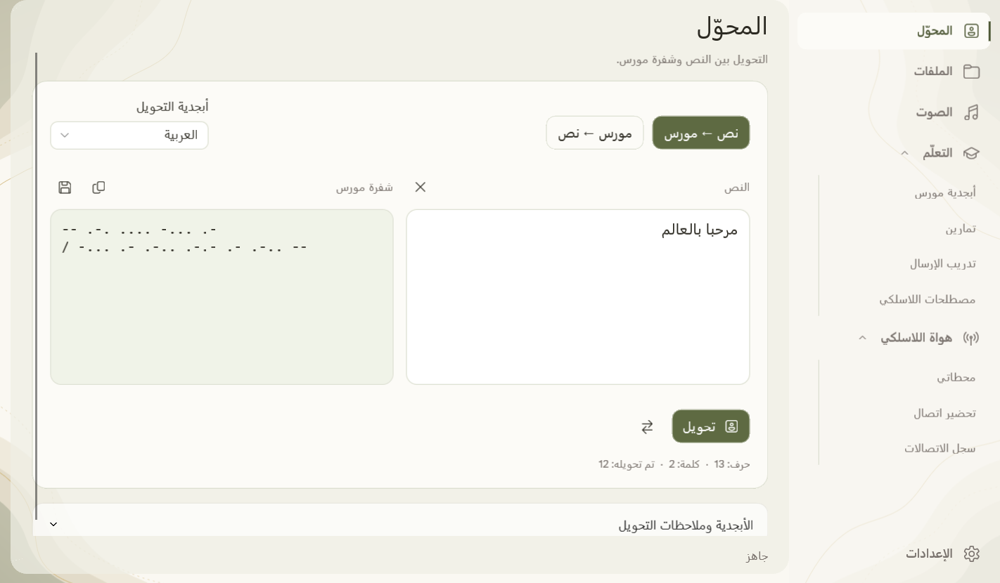
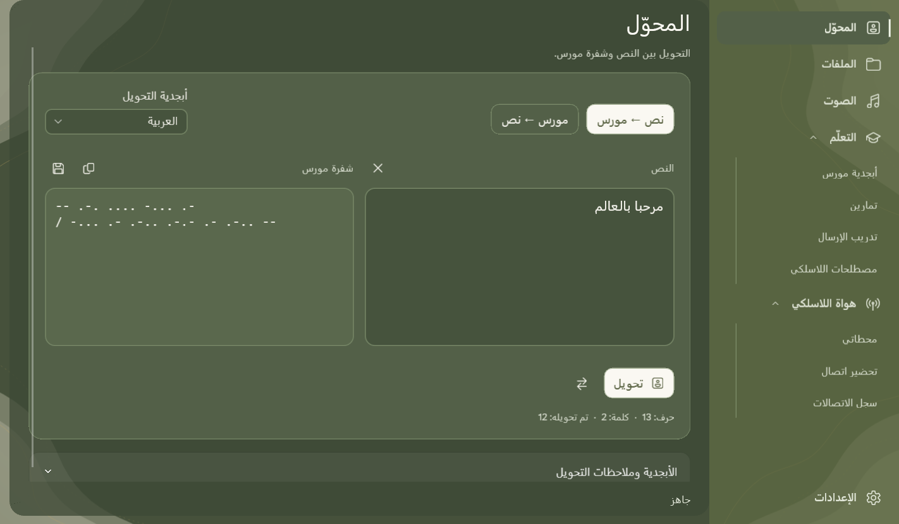
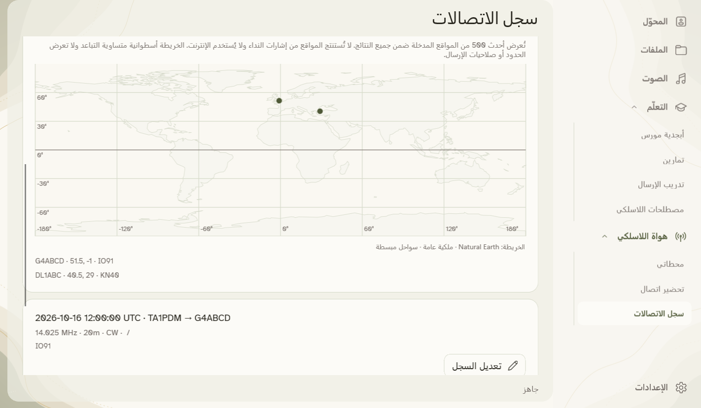

**اكتب رسالتك. استمع إلى مورس. تعلّم بالممارسة.**

[English](README.md) · [Türkçe](README.tr.md) · [Deutsch](README.de.md) · [Русский](README.ru.md) · **العربية**

MorseCore تطبيق مجاني لويندوز لتحويل النص إلى شفرة مورس والاستماع والتدريب. تبقى رسائلك على جهازك.

### ابدأ الاستخدام

1. **شغّل Setup** ثم افتح MorseCore من قائمة ابدأ.
2. اكتب رسالتك في **المحوّل** ثم حوّلها. افتح قسم **الصوت** للاستماع.
3. افتح **التعلّم** للأبجدية والتمارين واختصارات هواة اللاسلكي.

تفضّل الاستخدام دون تثبيت؟ فك ضغط [ملف ZIP المحمول](https://github.com/mustafamertakceylan/MorseCore/releases/download/v0.7.0/MorseCore-0.7.0-Windows-x64-Desktop.zip) وافتح **MorseCore.Desktop.exe**. هذه نسخة تجريبية غير موقّعة؛ قد يعرض ويندوز تحذيراً بشأن الناشر.

### ماذا يمكنك أن تفعل؟

- تحويل النصوص والملفات النصية في الاتجاهين، ملفاً واحداً أو مجموعة ملفات.
- الاستماع إلى مورس وحفظ ملفات WAV والتدرّب على إيقاع الإرسال.
- فك إشارات مورس النظيفة ذات النغمة الواحدة من ملفات WAV أو من مدخل صوت ويندوز.
- إدارة المحطات وتجهيز الرسائل وحفظ سجل اتصالات QSO مع استيراد ADIF وخريطة دون اتصال ضمن **هواة اللاسلكي**. ربط الأجهزة مخطّط له؛ التطبيق لا يبث إشارات راديوية.
- قراءة النص بصوت محلي عبر EMA Lightning وAntalia-2 Mini وPiper. ثبّت الصوت أول مرة عبر الإنترنت، ثم استمع دون اتصال.

### لغتك ومظهرك

**Türkçe · English · Deutsch · Русский · العربية**

تتوفر القوائم وأصوات اختيارية باللغات الخمس. يدعم تحويل النص الأبجدية اللاتينية/التركية والروسية والعربية. تكون القائمة العربية على اليمين، وتبقى شفرة مورس من اليسار إلى اليمين.

اختر المظهر الكريمي الفاتح أو الأخضر الداكن من الإعدادات. تتوقف حركة الخلفية الهادئة عندما تكون النافذة غير نشطة، ويمكن إيقافها بخيار تقليل الحركة.

<b>عرض المظهر الداكن وخريطة الاتصالات</b>

**متاح الآن لويندوز x64. إصدارات Linux وmacOS مخطّط لها.** لم تُحدَّد مواعيد الإصدار بعد.

### الشكر والترخيص

شكراً لـ **Canberk Aslan** على [EMA Lightning](https://github.com/canberk7/ema-lightning)، ولفريق **PatientDesk AI** على [Antalia-2 Mini](https://huggingface.co/cloud0day3/antalia-mini)، وللمساهمين في **Piper** على دعم القراءة الصوتية دون اتصال.

[Apache 2.0](LICENSE) · [الشكر وتراخيص المكوّنات](NOTICE) · [سجل التغييرات](CHANGELOG.md) · [إعداد الأصوات بالإنجليزية](docs/offline-speech.md) · [البناء من المصدر بالإنجليزية](docs/desktop.md)

