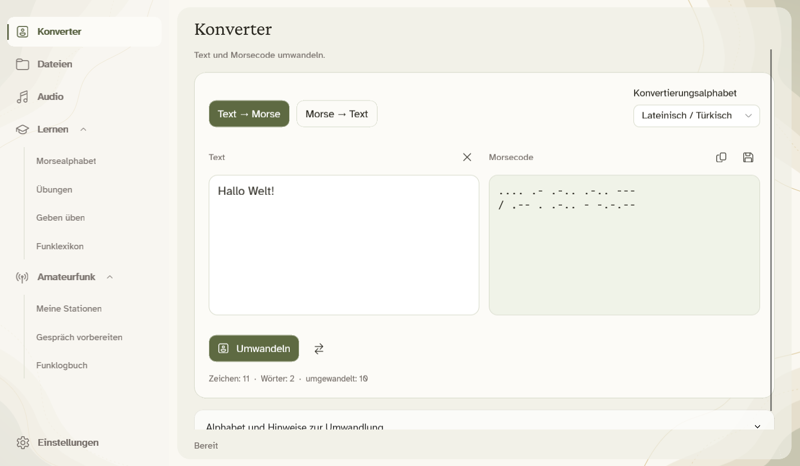
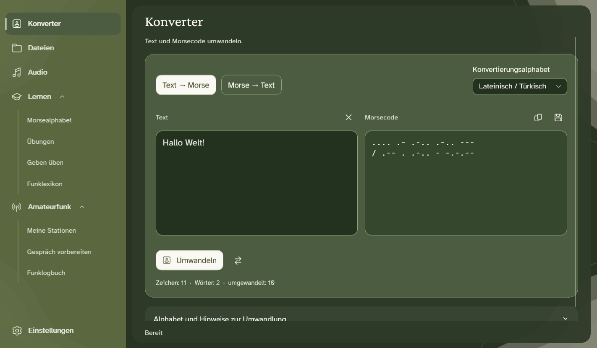
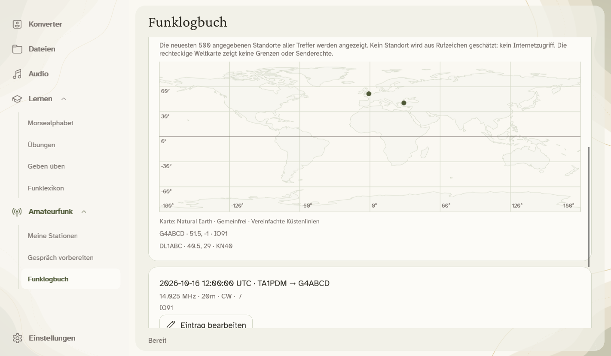

**Nachricht schreiben. Morse hören. Durch Üben lernen.**

[English](README.md) · [Türkçe](README.tr.md) · **Deutsch** · [Русский](README.ru.md) · [العربية](README.ar.md)

MorseCore ist eine kostenlose Windows-App zum Umwandeln von Text in Morsecode, Anhören und Üben. Deine Nachrichten bleiben auf deinem Computer.

### Loslegen

1. **Setup ausführen** und MorseCore im Startmenü öffnen.
2. Eine Nachricht unter **Konverter** eingeben und umwandeln. Zum Anhören **Audio** öffnen.
3. Unter **Lernen** findest du das Alphabet, Übungen und Funkabkürzungen.

Ohne Installation? Das [portable ZIP](https://github.com/mustafamertakceylan/MorseCore/releases/download/v0.7.4/MorseCore-0.7.4-Windows-x64-Desktop.zip) entpacken und **MorseCore.Desktop.exe** öffnen. Diese Vorschau ist nicht signiert; Windows kann eine Herausgeberwarnung anzeigen.

### Was kannst du tun?

- Text und Textdateien in beide Richtungen umwandeln, auch mehrere Dateien zugleich.
- Morse anhören, als WAV speichern und den eigenen Senderhythmus üben.
- Saubere Morseaufnahmen mit einem einzelnen Ton aus WAV-Dateien oder einem Windows-Audioeingang entschlüsseln.
- Unter **Amateurfunk** Stationen verwalten, Nachrichten vorbereiten und ein QSO-Logbuch mit ADIF-Import und Offlinekarte führen. Geräteanbindung ist geplant; die App sendet kein Funksignal.
- Text mit EMA Lightning, Antalia-2 Mini und Piper offline vorlesen lassen. Eine Stimme einmal online installieren, danach lokal anhören.

### Deine Sprache, dein Design

**Türkçe · English · Deutsch · Русский · العربية**

Menüs und optionale Stimmen gibt es in allen fünf Sprachen. Die Textumwandlung unterstützt Latein/Türkisch, Russisch und Arabisch. Arabische Menüs werden gespiegelt; Morse bleibt von links nach rechts.

In den Einstellungen stehen ein helles cremefarbenes und ein dunkelgrünes Design bereit. Die langsame Hintergrundbewegung pausiert im inaktiven Fenster und lässt sich mit der Option für reduzierte Bewegung ausschalten.

<b>Dunkles Design und Kontaktkarte ansehen</b>

**Jetzt für Windows x64. Linux und macOS sind geplant.** Veröffentlichungstermine stehen noch nicht fest.

### Danke & Lizenz

Danke an **Canberk Aslan** für [EMA Lightning](https://github.com/canberk7/ema-lightning), **PatientDesk AI** für [Antalia-2 Mini](https://huggingface.co/cloud0day3/antalia-mini) und die **Piper**-Mitwirkenden für die Offline-Sprachausgabe.

[Apache 2.0](LICENSE) · [Danksagung & Lizenzen](NOTICE) · [Versionshinweise](CHANGELOG.md) · [Stimmen einrichten (EN)](docs/offline-speech.md) · [Aus Quellcode bauen (EN)](docs/desktop.md)
