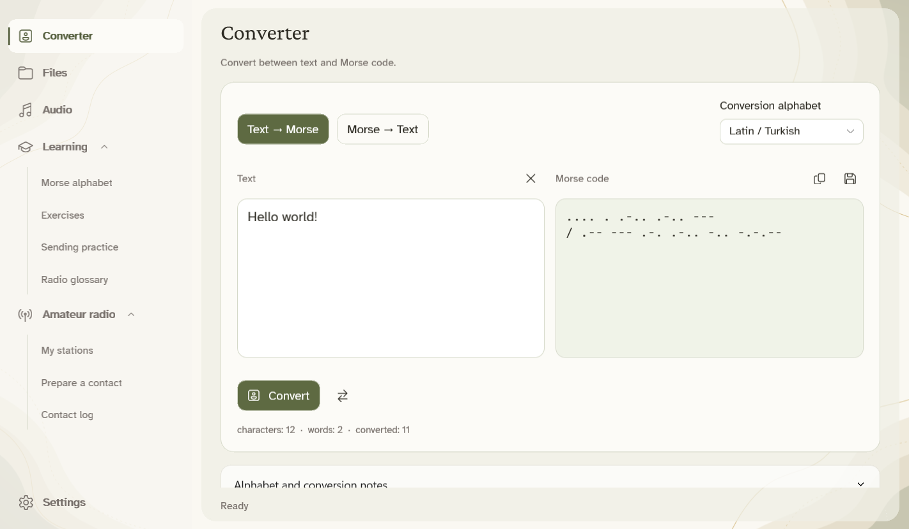
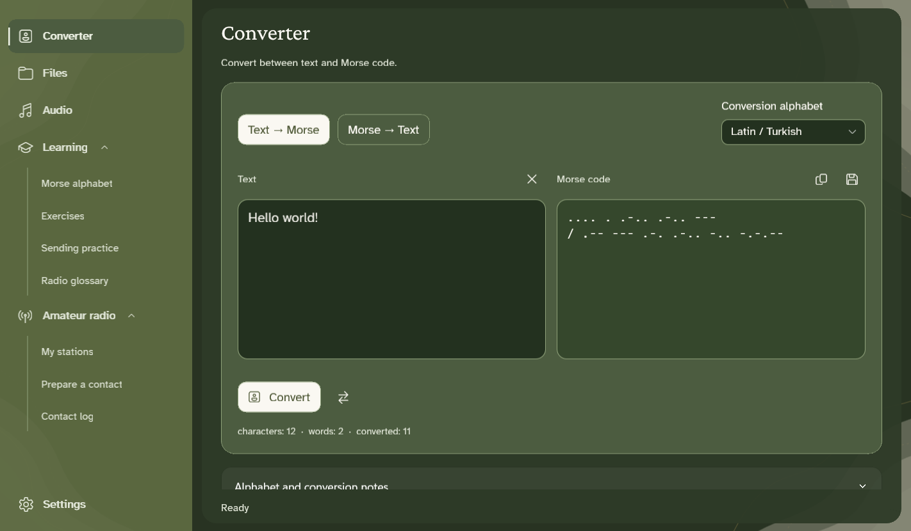
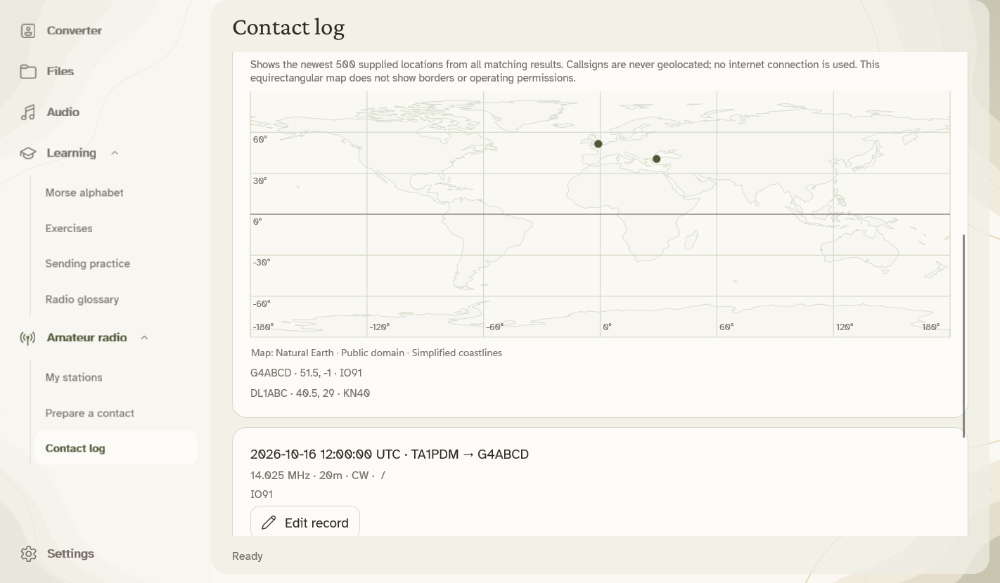

**Write a message. Hear Morse. Learn by practicing.**

**English** · [Türkçe](README.tr.md) · [Deutsch](README.de.md) · [Русский](README.ru.md) · [العربية](README.ar.md)

[**User guide · Wiki**](https://github.com/mustafamertakceylan/MorseCore/wiki/Getting-Started)

MorseCore is a free Windows, macOS and Linux app for converting text to Morse code, listening and practicing. Your messages stay on your computer.

**macOS:** open the [DMG](https://github.com/mustafamertakceylan/MorseCore/releases/download/v1.0.0/MorseCore-1.0.0-macOS-arm64.dmg), then drag MorseCore to Applications. This release is not notarized; macOS may require approval in Privacy & Security. See [Mac installation](docs/macos.md).

**Linux:** choose the `.deb` for Ubuntu, Debian or Pardus, or the portable archive and `PKGBUILD` for Arch. See [Linux installation](docs/linux.md).

### Get started

1. On Windows: **Run Setup**, then open MorseCore from the Start menu.
2. Type a message in **Converter** and choose **Convert**. Use **Audio** to listen.
3. Open **Learning** for the alphabet, exercises and radio abbreviations.

Prefer no installation? Extract the [portable ZIP](https://github.com/mustafamertakceylan/MorseCore/releases/download/v1.0.0/MorseCore-1.0.0-Windows-x64-Desktop.zip) and open **MorseCore.Desktop.exe**. This Windows build is unsigned; Windows may show a publisher warning.

### What can you do?

- Convert text and text files in both directions, including batches.
- Listen to Morse, save WAV files and practice sending with timing feedback.
- Decode clean, single-tone Morse from WAV files or a microphone.
- Use **Amateur radio** for station profiles, message preparation and a contact log with ADIF import and an offline map. Hardware connection is planned; the app does not transmit RF.
- Read text aloud offline. Install a voice once with internet, then listen locally. Thanks to EMA Lightning, Antalia-2 Mini and Piper.

### Your language, your theme

**Türkçe · English · Deutsch · Русский · العربية**

Menus and optional speech voices cover all five languages. Text conversion supports Latin/Turkish, Russian and Arabic. Arabic navigation mirrors; Morse stays left to right.

Choose the cream light theme or the green dark theme in Settings. Gentle background motion pauses when inactive; **Reduce motion** turns it off.

<b>See the dark theme and contact map</b>

**Available: Windows x64, macOS Apple Silicon (M1 or newer) and Linux x64.** [Linux installation](docs/linux.md) covers Ubuntu, Debian, Arch and Pardus.

### Thanks & license

Thanks to **Canberk Aslan** for [EMA Lightning](https://github.com/canberk7/ema-lightning), **PatientDesk AI** for [Antalia-2 Mini](https://huggingface.co/cloud0day3/antalia-mini), and the **Piper** contributors for offline speech.

[Apache 2.0](LICENSE) · [Credits & licenses](NOTICE) · [Release notes](CHANGELOG.md) · [Voice setup](docs/offline-speech.md) · [Build from source](docs/desktop.md)
