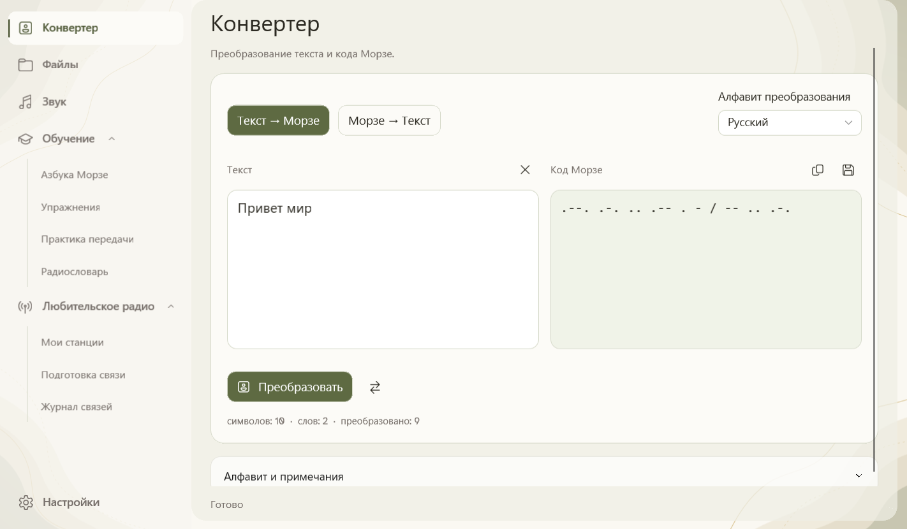
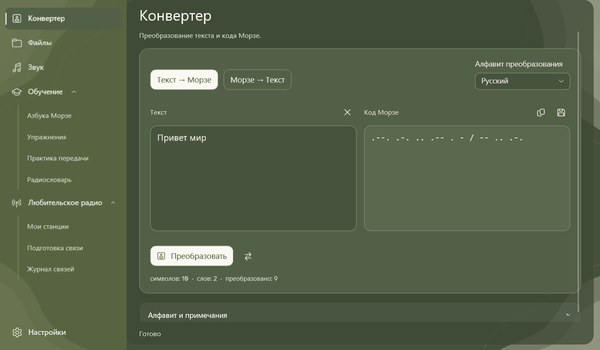
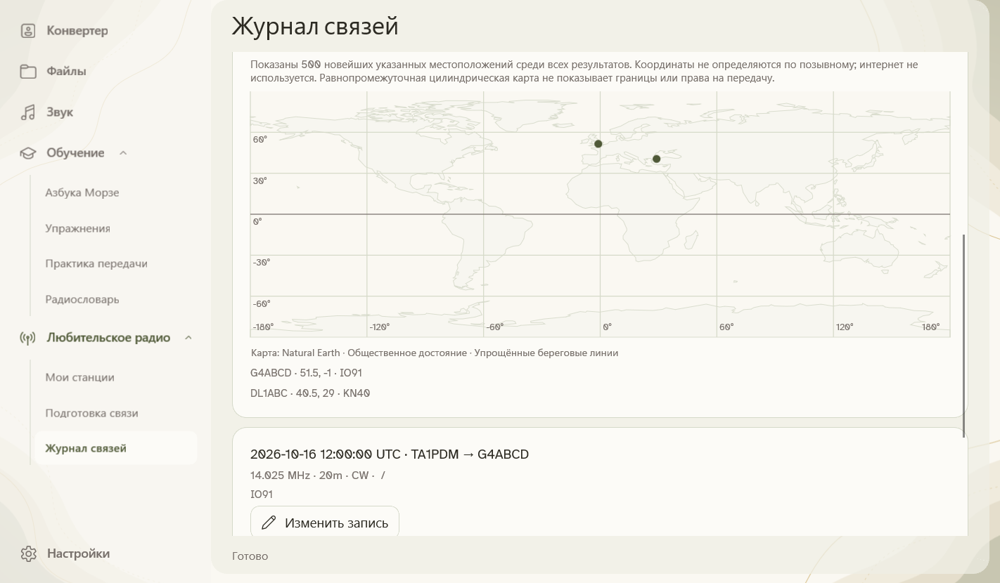

**Напиши сообщение. Послушай Морзе. Учись на практике.**

[English](README.md) · [Türkçe](README.tr.md) · [Deutsch](README.de.md) · **Русский** · [العربية](README.ar.md)

MorseCore — бесплатное приложение для Windows: преобразуй текст в код Морзе, слушай сигналы и тренируйся. Твои сообщения остаются на твоём компьютере.

### Начало работы

1. **Запусти Setup**, затем открой MorseCore через меню «Пуск».
2. Введи сообщение в **Конвертере** и запусти преобразование. Для прослушивания открой **Звук**.
3. В разделе **Обучение** находятся алфавит, упражнения и радиолюбительские сокращения.

Без установки? Распакуй [переносной ZIP](https://github.com/mustafamertakceylan/MorseCore/releases/download/v0.7.0/MorseCore-0.7.0-Windows-x64-Desktop.zip) и открой **MorseCore.Desktop.exe**. Эта предварительная версия не подписана; Windows может показать предупреждение об издателе.

### Что можно делать?

- Преобразовывать текст и текстовые файлы в обе стороны, в том числе пакетами.
- Слушать Морзе, сохранять WAV и тренировать собственный ритм передачи.
- Распознавать чистые однотональные сигналы Морзе из WAV-файла или аудиовхода Windows.
- В разделе **Любительское радио** управлять станциями, готовить сообщения и вести журнал QSO с импортом ADIF и офлайн-картой. Подключение оборудования запланировано; приложение не передаёт радиосигнал.
- Озвучивать текст офлайн с EMA Lightning, Antalia-2 Mini и Piper. Голос один раз скачивается через интернет, затем работает локально.

### Твой язык, твоя тема

**Türkçe · English · Deutsch · Русский · العربية**

Меню и дополнительные голоса доступны на всех пяти языках. Преобразование текста поддерживает латиницу/турецкий, русский и арабский алфавиты. В арабском интерфейсе меню зеркальное; Морзе остаётся слева направо.

В настройках можно выбрать светлую кремовую или тёмную зелёную тему. Плавное движение фона останавливается в неактивном окне и отключается настройкой уменьшения анимации.

<b>Тёмная тема и карта связей</b>

**Сейчас доступна версия для Windows x64. Linux и macOS запланированы.** Даты выхода пока не назначены.

### Благодарности и лицензия

Спасибо **Canberk Aslan** за [EMA Lightning](https://github.com/canberk7/ema-lightning), **PatientDesk AI** за [Antalia-2 Mini](https://huggingface.co/cloud0day3/antalia-mini) и участникам **Piper** за офлайн-озвучивание.

[Apache 2.0](LICENSE) · [Благодарности и лицензии](NOTICE) · [Изменения](CHANGELOG.md) · [Настройка голосов (EN)](docs/offline-speech.md) · [Сборка из исходников (EN)](docs/desktop.md)
