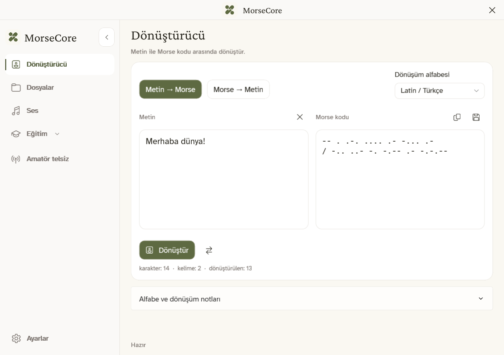
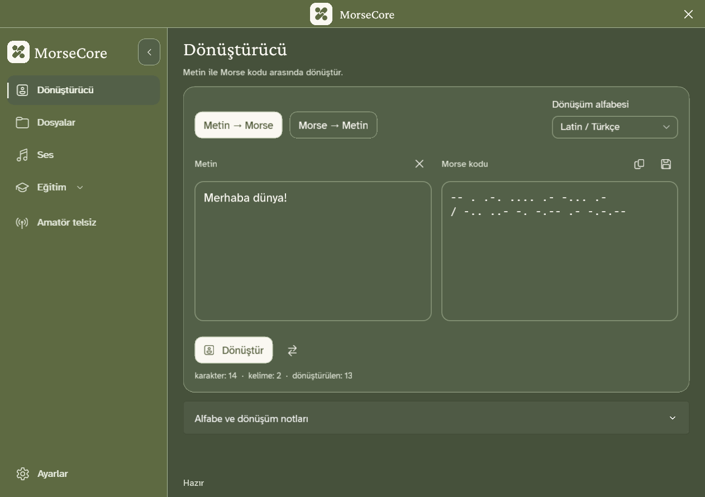
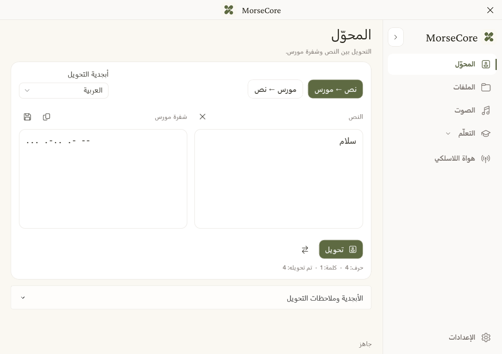
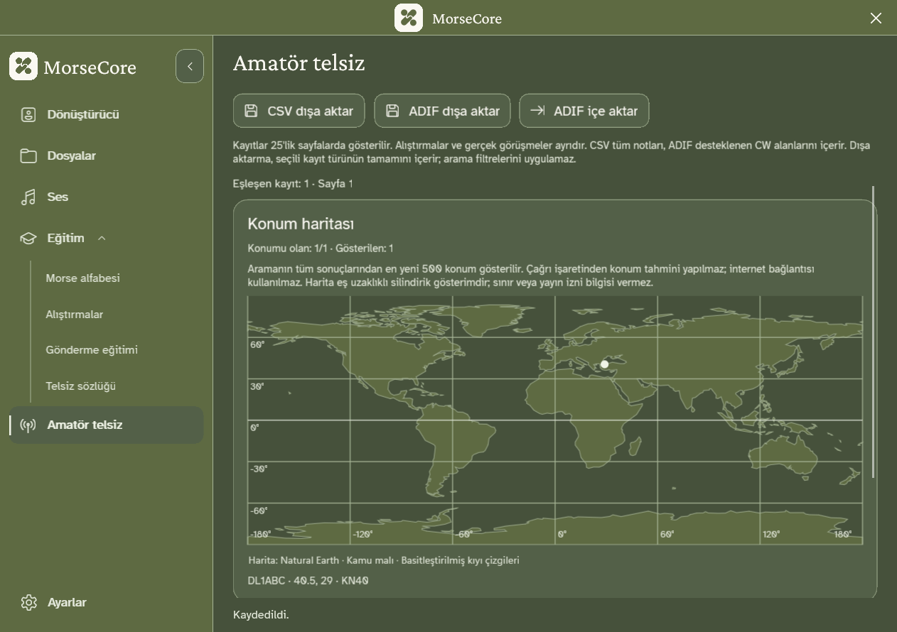

**Mesajını yaz. Morse'u dinle. Alıştırma yaparak öğren.**

[English](README.md) · **Türkçe**

MorseCore; metni Morse koduna çevirmek, dinlemek ve alıştırma yapmak için ücretsiz bir Windows uygulamasıdır. Mesajların bilgisayarında kalır.

### Hemen başla

1. **Setup'ı indirip çalıştır**, ardından Başlat menüsünden MorseCore'u aç.
2. **Dönüştürücü** bölümüne mesajını yaz ve **Dönüştür** düğmesine bas. Dinlemek için **Ses** bölümünü kullan.
3. Alfabe, alıştırmalar ve telsiz kısaltmaları için **Eğitim** bölümünü keşfet.

Kurmak istemiyorsan [taşınabilir ZIP'i](https://github.com/mustafamertakceylan/MorseCore/releases/download/v0.6.0/MorseCore-0.6.0-Windows-x64-Desktop.zip) indir, dosyaları çıkar ve **MorseCore.Desktop.exe** dosyasını aç. Güncel önizleme imzasızdır; Windows yayıncı uyarısı gösterebilir.

### Neler yapabilirsin?

- **Dönüştür:** Metinleri ve metin dosyalarını iki yönde, tek tek veya topluca çevir.
- **Dinle:** Morse kodunu dinle, WAV ses dosyası olarak kaydet.
- **Çalış:** Harf, kelime ve telsiz kısaltmalarıyla alıştırma yap; kendin Morse gönderip ritmini ölç.
- **Kaydı çöz:** WAV dosyasından veya Windows ses girişinden temiz, tek tonlu Morse kaydını metne çevir.
- **Telsiz günlüğünü tut:** İstasyonlar, hazır Morse mesajları, arama, düzenleme, ADIF içe aktarma ve çevrimdışı harita. Telsiz bağlantısı ilerisi için planlanıyor; uygulama RF yayını yapmaz.
- **Seslendir:** Sesleri uygulama içinden kur, örneklerini dinle ve paketlerini yönet. Metnin çevrimdışı okunur. [Ses kurulumu →](docs/offline-speech.tr.md)

### Kendi dilinde, kendi temanda

**Türkçe · English · Deutsch · Русский · العربية**

Beş dilde menü ve isteğe bağlı seslendirme desteği bulunur. Metin dönüşümü Latin/Türkçe, Rusça ve Arapça alfabelerini destekler. Arapçada menü sağa geçer; Morse soldan sağa kalır.

Ayarlar'dan krem renkli açık temayı veya yeşil koyu temayı seç.

<b>Diğer ekranları gör</b>

**Şimdi Windows x64'te. İleride Linux ve macOS'ta.** Yayın tarihleri henüz belirlenmedi.

### Teşekkürler ve lisans

[EMA Lightning](https://github.com/canberk7/ema-lightning) için **Canberk Aslan'a**, [Antalia-2 Mini](https://huggingface.co/cloud0day3/antalia-mini) için **PatientDesk AI ekibine** ve çevrimdışı seslendirmeyi sağlayan **Piper** katkıcılarına teşekkür ederiz.

[Apache 2.0](LICENSE) · [Katkılar ve bileşen lisansları](NOTICE) · [Sürüm notları](CHANGELOG.md) · [Kaynak koddan çalıştırma](docs/desktop.tr.md)
