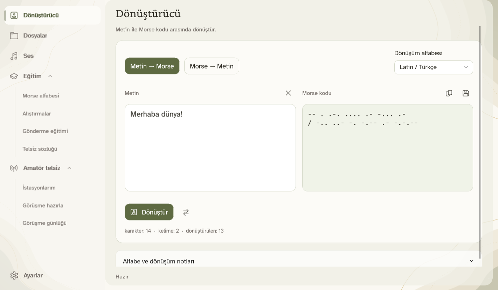
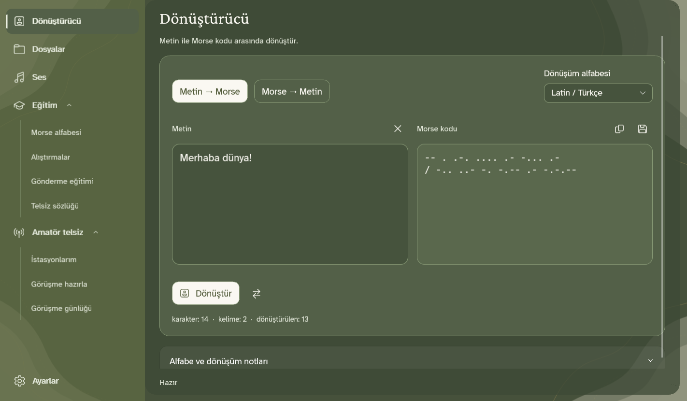
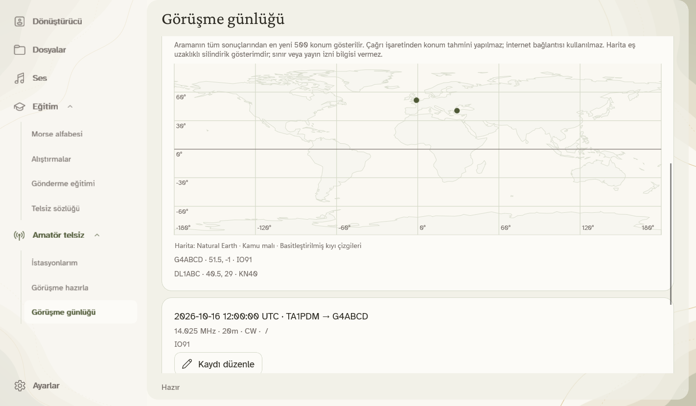

**Mesajını yaz. Morse'u dinle. Alıştırma yaparak öğren.**

[English](README.md) · **Türkçe** · [Deutsch](README.de.md) · [Русский](README.ru.md) · [العربية](README.ar.md)

MorseCore; metni Morse koduna çevirmek, dinlemek ve alıştırma yapmak için ücretsiz bir Windows uygulamasıdır. Mesajların bilgisayarında kalır.

### Hemen başla

1. **Setup’ı çalıştır**, ardından Başlat menüsünden MorseCore’u aç.
2. **Dönüştürücü** bölümüne mesajını yazıp **Dönüştür** düğmesine bas. Dinlemek için **Ses** bölümünü kullan.
3. Alfabe, alıştırmalar ve telsiz kısaltmaları için **Eğitim** bölümünü aç.

Kurmak istemiyorsan [taşınabilir ZIP’i](https://github.com/mustafamertakceylan/MorseCore/releases/download/v0.7.0/MorseCore-0.7.0-Windows-x64-Desktop.zip) çıkarıp **MorseCore.Desktop.exe** dosyasını aç. Bu önizleme imzasızdır; Windows yayıncı uyarısı gösterebilir.

### Neler yapabilirsin?

- Metinleri ve metin dosyalarını iki yönde, tek tek veya topluca çevir.
- Morse dinle, WAV kaydet ve kendin göndererek ritmini ölç.
- WAV dosyasından veya Windows ses girişinden temiz, tek tonlu Morse kaydını çöz.
- **Amatör telsiz** altında istasyonlarını yönet, mesaj hazırla, ADIF içe aktar ve çevrimdışı haritalı görüşme günlüğü tut. Cihaz bağlantısı planlanıyor; uygulama RF yayını yapmaz.
- EMA Lightning, Antalia-2 Mini ve Piper sesleriyle metni çevrimdışı seslendir. Sesi ilk kez internetle kur; sonrasında bilgisayarında dinle.

### Kendi dilinde, kendi temanda

**Türkçe · English · Deutsch · Русский · العربية**

Beş dilde menü ve isteğe bağlı seslendirme bulunur. Metin dönüşümü Latin/Türkçe, Rusça ve Arapça alfabelerini destekler. Arapçada menü sağa geçer; Morse soldan sağa kalır.

Ayarlar’dan krem açık temayı veya yeşil koyu temayı seç. Yavaş arka plan hareketi pencere etkin değilken durur; **Hareketi azalt** seçeneğiyle kapanır.

<b>Koyu temayı ve görüşme haritasını gör</b>

**Şimdi Windows x64’te. Linux ve macOS sürümleri planlanıyor.** Yayın tarihleri henüz belirlenmedi.

### Teşekkürler ve lisans

[EMA Lightning](https://github.com/canberk7/ema-lightning) için **Canberk Aslan’a**, [Antalia-2 Mini](https://huggingface.co/cloud0day3/antalia-mini) için **PatientDesk AI ekibine** ve çevrimdışı seslendirmeyi sağlayan **Piper** katkıcılarına teşekkür ederiz.

[Apache 2.0](LICENSE) · [Katkılar ve lisanslar](NOTICE) · [Sürüm notları](CHANGELOG.md) · [Ses kurulumu](docs/offline-speech.tr.md) · [Kaynak koddan çalıştırma](docs/desktop.tr.md)
